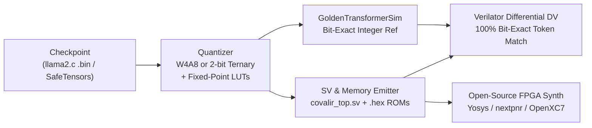

[](https://github.com/covalir/covalir/actions/workflows/ci.yml)
[](https://covalir.github.io/covalir/)
[](LICENSE)
[](util/dvsim/run_dv.py)
[](hw/ip/prim/formal/prim_fifo_sync.sby)

## CovalIR's open-source LLM-to-SystemVerilog FPGA compiler

[CovalIR](https://covalir.github.io/covalir/) is an open-source compiler and verified SystemVerilog IP library that lowers Llama-2 / TinyStories checkpoints into **100% pure-integer** (zero floating-point) hardware for FPGAs — supporting both **Group-32 W4A8** (`INT4 × INT8`) and **zero-multiplier 2-bit ternary** (`{-1, 0, +1} × INT8`) datapaths over `Q8.8` (`INT16`) activations.

`covalir compile` loads Karpathy `llama2.c` `.bin`, HuggingFace `.safetensors`, or synthetic checkpoints, quantizes weights and fixed-point LUTs (`RMSNorm`, `RoPE`, `SiLU`, `Softmax`), emits packed `.hex` memory images + parameterized SystemVerilog (`covalir_llm_core`), and proves **100% bit-exact 48-bit logits and autoregressive tokens** against `golden_sim.py` in Verilator. On real Karpathy **`stories15M.bin`** (15.19M parameters, 6 layers, 32k vocab, `w4a8`, `Lanes=16`, `GroupSize=32`), compiled SystemVerilog RTL simulates 16 autoregressive steps (`32,547,278` cycles, `2,034,204` cycles/token) bit-exact vs. `golden_sim.py` and **matches FP32 16/16 tokens** (`" Once upon a time, there was a little girl named Lily. She loved"`). Physical FPGA board & AWS F2 hardware measurements are next — zero unmeasured hardware TPS numbers are claimed. See [STATUS.md](STATUS.md) and **[covalir.github.io/covalir](https://covalir.github.io/covalir/)**.

---

## Compiler Pipeline



---

## Quick Start

Requires `verilator >= 5.0` and `python3 >= 3.11` (no PyTorch or NumPy required):

```bash
# 1. Compile a model (or real `stories15M.bin` / HF SafeTensors dir) to SystemVerilog & verify bit-exact in Verilator
PYTHONPATH=compiler python3 -m covalir.cli compile synthetic --quant ternary --lanes 16 --out build/demo_ternary --sim
PYTHONPATH=compiler python3 -m covalir.cli compile synthetic --quant w4a8    --lanes 16 --out build/demo_w4a8    --sim

# Optional: compile & bit-exact Verilator-simulate real Karpathy stories15M.bin (matches FP32 16/16 tokens!)
PYTHONPATH=compiler python3 -m covalir.cli compile stories15M.bin \
  --quant w4a8 --lanes 16 --group-size 32 --tokenizer tokenizer.bin \
  --prompt 1 --gen-steps 15 --out build/stories15m_w4a8 --sim

# 2. Run all Python unit tests (golden math, requant, checkpoint loader, quantizer, golden_sim, emitter)
python3 -m unittest discover -s compiler/tests -v

# 3. Run full Verilator strict lint, 8 elaboration guard tests, all 5 IP differential sims,
#    and both end-to-end compiled Transformer bit-exact proofs (W4A8 & Ternary)
python3 util/dvsim/run_dv.py

# 4. Run open-source Yosys synthesis (requires OSS CAD Suite; also automated in CI)
./targets/fpga_foss/build_yosys.sh build/demo_ternary generic
```

---

## Repository Layout

```text
covalir/
├── hw/
│   ├── ip/
│   │   ├── prim/             # Low-latency sync FIFO + SymbiYosys formal (prove+cover) + C++ DV
│   │   ├── prim_generic/     # Behavioral 1R1W SRAM (byte mask, rvalid_o, read-first) + C++ DV
│   │   ├── mac_w4a8/         # Pipelined INT4 x INT8 -> signed AccWidth MAC + C++ DV
│   │   ├── mac_ternary/      # Pipelined 2-bit ternary x INT8 zero-multiplier MAC + C++ DV
│   │   ├── requant_group/    # Pipelined INT32 -> INT8 fixed-point scaler & saturator + C++ DV
│   │   ├── transformer_core/ # Full autoregressive Llama-2 / TinyStories Transformer RTL core
│   │   ├── prim_xilinx_usp/  # Planned Phase 2: UltraScale+ DSP/URAM wrappers
│   │   └── prim_asic/        # Planned future: ASIC SRAM macro wrappers
│   ├── top_llm/              # Compiled top-level output target notes
│   └── lint/                 # Verible SystemVerilog style rules
├── compiler/covalir/
│   ├── front/                # Zero-dependency `.bin` (llama2.c) & `.safetensors` loaders
│   ├── quant/                # W4A8 & 2-bit ternary quantizer, golden.py & GoldenTransformerSim
│   ├── gen/                  # SystemVerilog + .hex memory image + Yosys script emitter
│   └── cli.py                # `covalir compile`, `covalir sim`, `covalir gen-vectors`, `info`
├── targets/
│   ├── fpga_foss/            # Yosys generic / ECP5 / Gowin synthesis runner (`build_yosys.sh`)
│   └── aws_f2/               # Planned Phase 1/2 AWS F2 target notes
├── util/
│   └── dvsim/                # Full Verilator lint, guard tests, IP DV & E2E Transformer runner
├── docs/                     # Material for MkDocs site (GitHub Pages), Phase 1 Spec & Roofline Plan
├── mkdocs.yml                # GitHub Pages documentation config (`mkdocs-material`)
└── STATUS.md                 # Exact implemented vs. pending ledger
```

---

## Documentation

* **Live Docs Site (GitHub Pages):** **[https://covalir.github.io/covalir/](https://covalir.github.io/covalir/)**
* [STATUS.md](STATUS.md) — Exact breakdown of locally verified, CI-gated, and pending hardware items.
* [Phase 1 Specification](docs/specs/phase1_tinystories15m.md) — Bit-exact fixed-point Transformer contract.
* [Architecture & Roofline Plan](docs/ARCHITECTURE_MASTERPLAN.md) — Formula-verified roofline physics and Phase 2 entry gates.
* [Monorepo & EDA Blueprint](docs/OPENTITAN_ORG_BLUEPRINT.md) — Single-monorepo setup (`github.com/covalir/covalir`).

## License

Licensed under the **Apache License 2.0** (see [LICENSE](LICENSE)).
