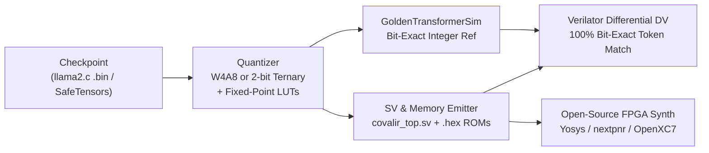

# CovalIR

**Open-source LLM-to-SystemVerilog compiler for FPGAs.**

!!! info "Live Status"
    CovalIR never claims capabilities, formal proofs, or hardware throughput numbers that have not been run and reproduced. **Phase 1 compiler + end-to-end pure-integer Transformer RTL (`w4a8` and zero-multiplier 2-bit `ternary`) are verified 4/4 green in Verilator, SymbiYosys, Yosys, and Verible CI — and real Karpathy `stories15M.bin` (15.19M params) compiles and runs 16/16 tokens bit-exact in Verilator matching FP32 identically (`" Once upon a time, there was a little girl named Lily. She loved"`).** Physical FPGA board and AWS F2 hardware measurements are next — see [Implementation Status](status.md).

---

## Compiler Pipeline



---

## Quick Start

Requires `verilator >= 5.0` and `python3 >= 3.11` (no PyTorch or NumPy required):

```bash
git clone https://github.com/covalir/covalir.git
cd covalir

# 1. Compile a Transformer to zero-multiplier 2-bit ternary SystemVerilog & prove bit-exactness
PYTHONPATH=compiler python3 -m covalir.cli compile synthetic --quant ternary --lanes 16 --out build/demo_ternary --sim

# 2. Run the full verification suite (lint, 8 parameter guards, 5 IP sims, 2 E2E Transformer proofs)
python3 util/dvsim/run_dv.py
```

---

## Core Architecture

| Layer | What CovalIR Ships Today |
|---|---|
| **Zero-Multiplier 2-Bit Ternary & W4A8** | Parameterized 2-stage pipelined `mac_ternary` (`{-1,0,+1} × INT8`, 0 hardware multipliers) and `mac_w4a8` (`INT4 × INT8`), both backed by `prim_fifo_sync #(Depth=2)` output decoupling (zero combinational `out_ready_i → in_ready_o` paths). |
| **Bit-Exact End-to-End Transformer RTL** | `covalir_llm_core.sv` runs `Q8.8` (`INT16`) activations & KV-cache, CLZ-normalized RMSNorm LUT, dynamic power-of-2 INT8 absmax quantization, Group-32 `Q1.15` scaled MAC accumulation, `Q1.14` RoPE, causal MHA + exact 40-cycle restoring divider, 512-entry `Q8.8` SwiGLU, LM head, and deterministic 48-bit argmax — matching `golden_sim.py` bit-for-bit across every token and logit (and matching FP32 16/16 tokens on real `stories15M.bin`). |
| **OpenTitan-Inspired Verification Rigor** | FuseSoC `CAPI=2` `.core` manifests, Verilator `-Wall -Werror`, negative elaboration parameter guards, SymbiYosys formal (`prove` + `cover`), Yosys generic synthesis, and Verible style lint on every commit. |
| **Formula-Verified Roofline Physics** | Every projected cloud/edge number in [Roofline & Phase 1 Plan](ARCHITECTURE_MASTERPLAN.md) is strictly capped by sustained memory bandwidth (`60–80%` HBM efficiency) with mandatory hardware disclosure rules. |
